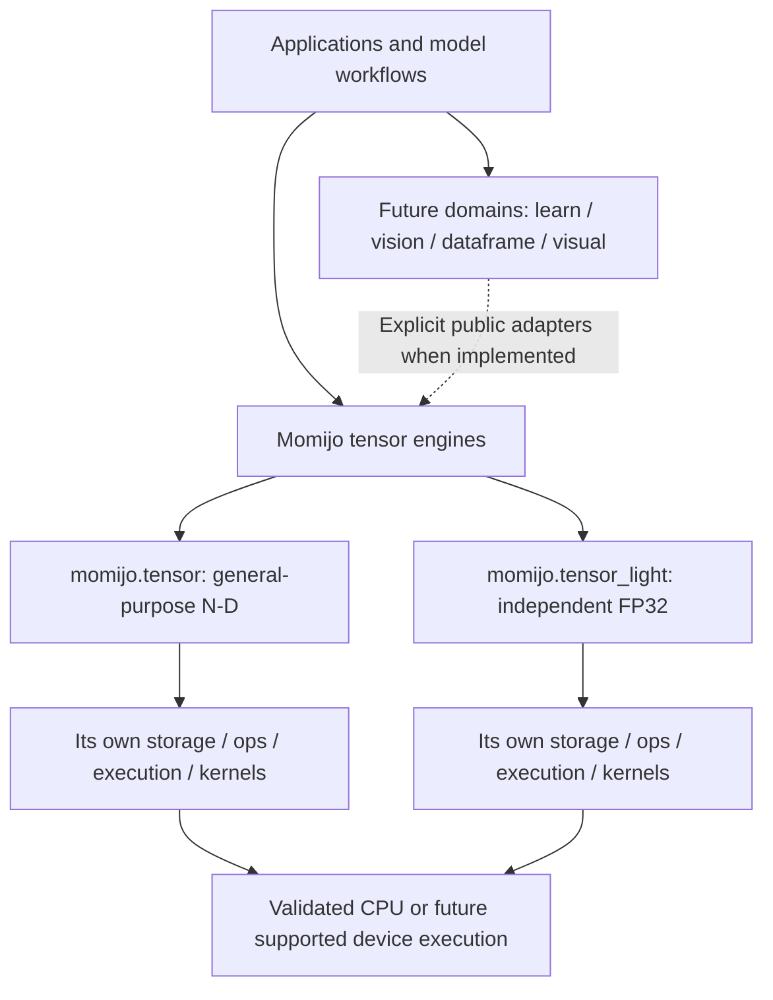
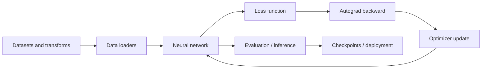

<!-- SPDX-FileCopyrightText: 2026 Morteza Taleblou -->
<!-- SPDX-FileCopyrightText: 2026 Mitra Daneshmand -->
<!-- SPDX-License-Identifier: MIT -->

<div align="center">


# Momijo

### A high-performance, Mojo-native foundation for the next generation of AI

**Building toward a complete, open-source alternative to PyTorch — from tensor computation to model training and inference.**

[](https://www.modular.com/mojo)
[](LICENSE)


[Vision](#vision-and-goals) · [Current status](#current-implementation-status) · [Architecture](#architecture) · [Roadmap](#development-roadmap) · [Getting started](#getting-started) · [Contributors](#authors-ownership-and-governance) · [License](#license)

</div>

> **Project status:** Momijo already contains **two independent Mojo tensor-engine source implementations** and native Mojo tests, examples, benchmarks, and compiler-facing build tasks. The larger deep-learning framework is a **development target**, not a finished or PyTorch-compatible product. Compilation, runtime correctness, GPU support, and performance must be demonstrated on supported machines before being claimed.

## What is Momijo?

**Momijo** is an open-source artificial intelligence and numerical computing project written in **Mojo**. Its long-term purpose is to provide a cohesive framework for tensor mathematics, automatic differentiation, neural networks, data processing, computer vision, and efficient model execution — with the ambition of replacing PyTorch in the use cases it eventually supports.

Momijo is developed independently from **[Momiru](https://github.com/taleblou/momiru)**, the related **Rust-native** project. The two projects share a direction and maintainers, but they do not share an implementation or promise identical APIs.

## Vision and goals

Our goal is to make Momijo a practical platform for **research, training, inference, and deployment**, while keeping its architecture transparent and its performance claims reproducible.

1. **Performance:** minimize avoidable allocations, copies, synchronization, and dispatch overhead; develop optimized CPU and, when verified, GPU execution.
2. **Numerical correctness:** define shapes, dtypes, broadcasting, reductions, precision, and edge-case behavior explicitly.
3. **Differentiable computing:** add reverse-mode automatic differentiation and trustworthy gradient validation.
4. **Deep learning:** build reusable layers, models, losses, optimizers, schedulers, data loaders, and checkpointing.
5. **Usability:** provide consistent, documented public APIs with straightforward examples and predictable errors.
6. **Reproducibility:** test features, preserve benchmark methodology, and report known hardware/toolchain limits.
7. **Ecosystem:** extend the foundation to vision, dataframes, visualization, mixed precision, and scalable execution.

**PyTorch replacement is a long-term objective, not a current equivalence claim.** API compatibility, feature coverage, and relative speed must be evaluated per operation and workload; existing PyTorch code is not assumed to run unchanged.

## Current implementation status

The status below describes the checked-in source tree reviewed on **11 November 2026**. **Source present** means code exists in the tree; it does **not** mean a compiler, device, benchmark, or release gate has passed.

| Area | Status in this source snapshot | Scope / evidence |
| --- | --- | --- |
| `momijo.tensor` | **Source present** | General-purpose tensor engine: storage, shape, indexing/views, operations, execution, kernels, device/backend abstractions. |
| `momijo.tensor_light` | **Source present** | Independent FP32-oriented tensor engine with its own implementation, operations, execution, and canonical test/benchmark cases. |
| Tests and examples | **Sources present** | Separate suites for both tensor engines under `tests/` and `examples/`. |
| Benchmark programs | **Sources present** | CPU-oriented tensor benchmark programs; published speedup claims require actual measurements. |
| Build and automation | **Present** | Pixi/CLI tasks for Mojo-only smoke tests and executable test discovery, AOT precompile, and CI/release workflows. |
| Source-structure validation | **Checked in this review** | Native-language-only file inventory, module markers, attribution, and documentation links were checked without claiming compiler success. |
| Mojo compilation and full runtime test pass | **Not verified in this review** | Requires the pinned Mojo/MAX toolchain and platform-specific execution. |
| `momijo.dataframe` | **Reserved only** | Namespace and supporting documentation placeholders; no data-frame API implemented. |
| `momijo.learn` | **Reserved only** | Namespace and documentation placeholders; autograd/NN/training are future development work. |
| `momijo.vision` | **Reserved only** | Namespace and documentation placeholders; no vision API implemented. |
| `momijo.visual` | **Reserved only** | Namespace and documentation placeholders; no visualization API implemented. |

**Programming-language source policy:** this repository contains only `.mojo` code; Markdown, TOML, YAML and GitHub metadata are documentation and configuration, not additional library implementations. The four future application domains are **single namespaces**. No `dataframe_light`, `learn_light`, `vision_light`, or `visual_light` branches are part of the intended structure. The existing `tensor_light` engine remains independent.

## Architecture

### One package, two independent tensor engines

```text
momijo/
├── src/momijo/
│   ├── tensor/              # General-purpose tensor engine (source present)
│   ├── tensor_light/        # Independent FP32-oriented engine (source present)
│   ├── dataframe/           # Reserved: future data processing APIs
│   ├── learn/               # Reserved: future autograd / neural networks
│   ├── vision/              # Reserved: future computer vision
│   └── visual/              # Reserved: future visualization
├── tests/                  # Mojo tensor suites and future placeholders
├── examples/               # Tensor demonstrations, future placeholders
├── benchmarks/             # Independent tensor measurement programs
├── docs/                   # Architecture, development, guides and design decisions
├── .github/                # CI, security and contribution workflows
├── pixi.toml               # Pinned development environment and tasks
└── LICENSE                 # MIT, both copyright holders
```

The two tensor engines have **separate source trees and internal execution contracts**. Neither imports the other's implementation. Application modules, when built, should depend on documented public tensor interfaces through explicit adapters, without introducing silent conversions or circular dependencies.



The diagram describes the **intended layering**. The future domains are not currently functional. GPU and other backend capabilities must be tested separately rather than inferred from source directory names.

For precise architecture and dependency contracts, read [overview](docs/architecture/overview.md), [module boundaries](docs/architecture/module-boundaries.md), [application domains](docs/architecture/application-domains.md), and [ADR 0001](docs/adr/0001-one-package-independent-tensor-engines.md).

## Development roadmap

The following phases are **engineering targets, not promises of shipped functionality or release dates**. Implementation status is determined by tests and release evidence, not directory existence.

| Phase | Focus | Expected deliverables | Completion criteria | Position |
| --- | --- | --- | --- | --- |
| **M0 — Foundation** | Repository and tensor source consolidation | One package, independent engines, docs, tests/examples/benchmarks, dual-author MIT attribution. | Source structure, language policy and documentation checked. | **Source established; structural audit checked** |
| **M1 — Verified tensor baseline** | Make the existing tensor engines reliably executable | Resolve dependencies, compile both engines, run CPU smoke/full regression suites, verify supported dtypes/shapes. | Reproducible passing build/test logs on documented machines. | **Next verification gate** |
| **M2 — Tensor performance and backends** | Improve numerical kernels and memory behavior | Measured CPU optimizations; supported GPU/accelerator paths only after device-specific validation; AOT packaging. | Numerical parity plus repeatable per-device benchmarks and artifact verification. | Planned/partially scaffolded |
| **M3 — Autograd core** | Differentiable tensor computation | Gradient tracking, reverse-mode graph, backward rules, gradient accumulation and control. | Finite-difference, analytical and reference-framework gradient tests. | Planned |
| **M4 — `learn` framework** | End-to-end model training | Layers, modules, losses, optimizers, learning-rate schedulers, datasets/loaders, checkpointing. | Reproducible training, evaluation and model restoration examples. | Planned |
| **M5 — Application domains** | Prepare broader AI workloads | `vision`, `dataframe`, `visual` APIs with clear tensor adapters and independent tests. | Real modules, public examples, supported-platform documentation. | Reserved today |
| **M6 — Advanced AI runtime** | Scale capabilities | Mixed precision, attention/Transformers, optimized inference, multi-device/distributed execution where feasible. | Explicit hardware matrices, convergence tests and measured workloads. | Long-term goal |
| **M7 — Mature public releases** | Dependable PyTorch-alternative workflows | Versioned documentation, compatibility matrix, stable supported APIs, release artifacts. | Published CI results, migration guides, licensing audit and reproducible performance evidence. | Long-term goal |

### What happens next?

**Next immediate step: verify and publish the tensor baseline**, before describing the full framework as usable. In particular, generate a real `pixi.lock` with network access, compile both tensor engines with the pinned toolchain, run the smoke and full test suites, and document results and any limitations. Then prioritize autograd and the first complete neural-network training example.

### Intended model-training workflow (future)



This is a **target workflow**; `learn` and its associated training interfaces are not implemented in this snapshot.

## Getting started

### Requirements

- Declared development targets in `pixi.toml`: Linux `linux-64` / `linux-aarch64` and macOS `osx-arm64` (not verified on every target); use WSL2 Linux for Windows development rather than assuming a native Windows Mojo build.
- [Pixi](https://pixi.sh) and access to the Modular/conda channels.
- The snapshot declares **Mojo 1.1.0** and **MAX 26.6.0** targets. Actual dependency resolution and compiler compatibility must be verified on each supported target; no second programming language is needed in the repository.
- GPU runtime and supported devices for any future GPU-specific validation.

```bash
# Run these from the repository root.
pixi lock                 # Resolve a genuine pixi.lock; not included in the ZIP
pixi install
pixi run list-tests      # Enumerate runnable Mojo test entries
pixi run test-smoke      # Compile and run both tensor smoke tests
pixi run test-tensor     # Compile and run the full general-tensor suite
pixi run test-tensor-light # Compile and run the FP32 Light suite
pixi run test-all        # Both suites, sequentially
```

Run a concrete demonstration for each **existing** tensor engine:

```bash
pixi run mojo run -I src -I . examples/tensor/creation.mojo
pixi run mojo run -I src -I . examples/tensor_light/creation.mojo
```

Package precompilation is a **candidate build operation**, not evidence that a binary or universal artifact has been published. The Linux release workflow records separate `dist/SOURCE-SHA256SUMS` and `dist/ARTIFACT-SHA256SUMS` manifests so that the downloaded compiler artifact can be checked without requiring the full source tree; source verification uses the recorded Git commit:

```bash
pixi run package
test -s dist/momijo.mojoc   # Verify that an artifact was generated
```

See [getting started](docs/getting-started.md), [development setup](docs/development/setup.md), [compatibility](docs/compatibility.md), [testing](docs/development/testing.md), and [AOT artifacts](docs/architecture/aot-and-artifacts.md). **Filesystem checks cannot substitute for Mojo compilation or runtime tests.**

## Testing, benchmarking and release standards

A Momijo feature is eligible to be described as **verified** only when its applicable gates pass:

- **Correctness:** independently checked results, errors, empty/scalar/edge cases, shape/stride/dtype behavior.
- **Autograd (when implemented):** analytic and numerical gradient checks, including broadcasting and reduction rules.
- **Execution:** actual compiler/runtime passes on declared CPU and GPU configurations; no false GPU pass from a CPU-only run.
- **Performance:** comparable workload, same precision, stated compiler/hardware, warmup, timing boundaries, memory and baseline.
- **Packaging:** reproducible dependency resolution, valid precompiled artifacts, source identity and license inclusion.
- **Releases:** documented supported features, limitations, version changes and clear pass/fail/skip evidence.

Benchmark source files are **not benchmark results**. A planned or `NOT_RUN` case must never be described as passing. See [benchmarking](docs/performance/benchmarking.md) and [reproducibility](docs/performance/reproducibility.md).

## Documentation and contribution

| Resource | Purpose |
| --- | --- |
| [Documentation index](docs/README.md) | Navigation across API references, architecture, guides and future domains. |
| [API reference](docs/api/README.md) | Engine-specific contracts and source-linked inventories of 801 package exports plus owning `Tensor` method names. |
| [Compatibility matrix](docs/compatibility.md) | Declared Mojo/MAX version and platform targets, with explicit unverified areas. |
| [Troubleshooting](docs/troubleshooting.md) | Diagnose environment, imports, checked results, device and AOT failures. |
| [Release readiness](docs/development/release-readiness.md) | Source-publication versus compiler/release acceptance gates. |
| [Tensor guide](docs/guides/tensor.md) | General tensor concepts and examples. |
| [Tensor Light guide](docs/guides/tensor-light.md) | Independent FP32 tensor concepts and examples. |
| [Contributing](CONTRIBUTING.md) | Development workflow and PR expectations. |
| [Security](SECURITY.md) | Responsible vulnerability reporting. |
| [Code of Conduct](CODE_OF_CONDUCT.md) | Community conduct. |
| [Changelog](CHANGELOG.md) | Source/package evolution and validation notes. |
| [Support](SUPPORT.md) | Help and project communication. |

Contributions should preserve independent tensor-engine boundaries, include meaningful tests, use reproducible performance evidence for optimization claims, and follow the existing English-language source/documentation conventions.

## Authors, ownership and governance

Momijo is jointly created and stewarded by **two founders, authors, and project co-owners**:

| Contributor | Roles |
| --- | --- |
| **Morteza Taleblou** | Co-founder · Co-owner · Author · Maintainer · Copyright holder |
| **Mitra Daneshmand** | Co-founder · Co-owner · Author · Maintainer · Copyright holder |

Both names appear in the source SPDX notices and the repository's MIT license. **Project co-ownership and authorship are distinct from GitHub administrative permissions:** actual repository collaborator access and branch protection are configured separately.

**Repository:** [github.com/taleblou/momijo](https://github.com/taleblou/momijo)  
**Related Rust project:** [github.com/taleblou/momiru](https://github.com/taleblou/momiru)  
**Project website:** [taleblou.ir](https://taleblou.ir/)

## License

Momijo is released under the **[MIT License](LICENSE)**.

```text
Copyright (c) 2026 Morteza Taleblou
Copyright (c) 2026 Mitra Daneshmand
```

The MIT license permits use, modification and redistribution under its license-notice and copyright-preservation conditions. See the actual [LICENSE](LICENSE) file for the full terms and warranty disclaimer.

---

**Momijo:** an implemented tensor foundation today, with the long-term ambition to become a complete, trustworthy, high-performance Mojo-native AI framework.
